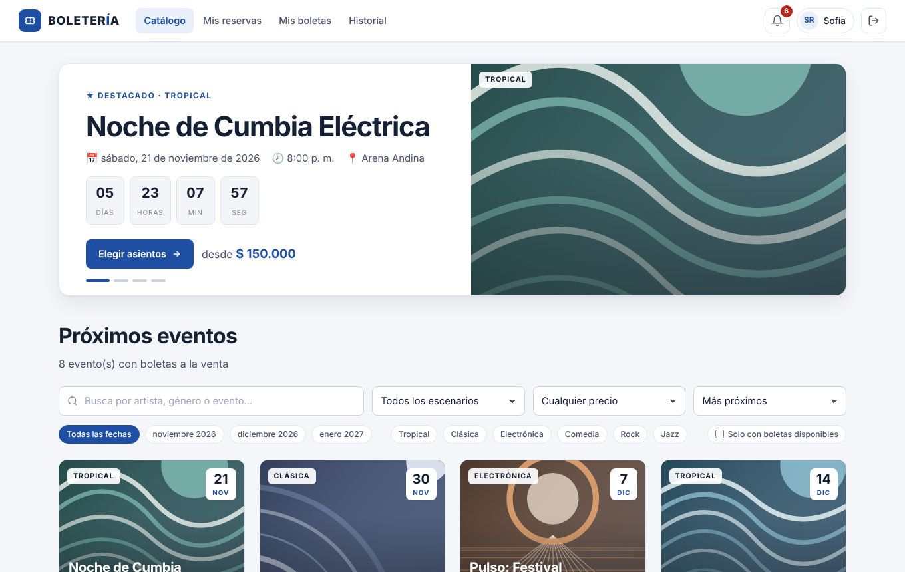
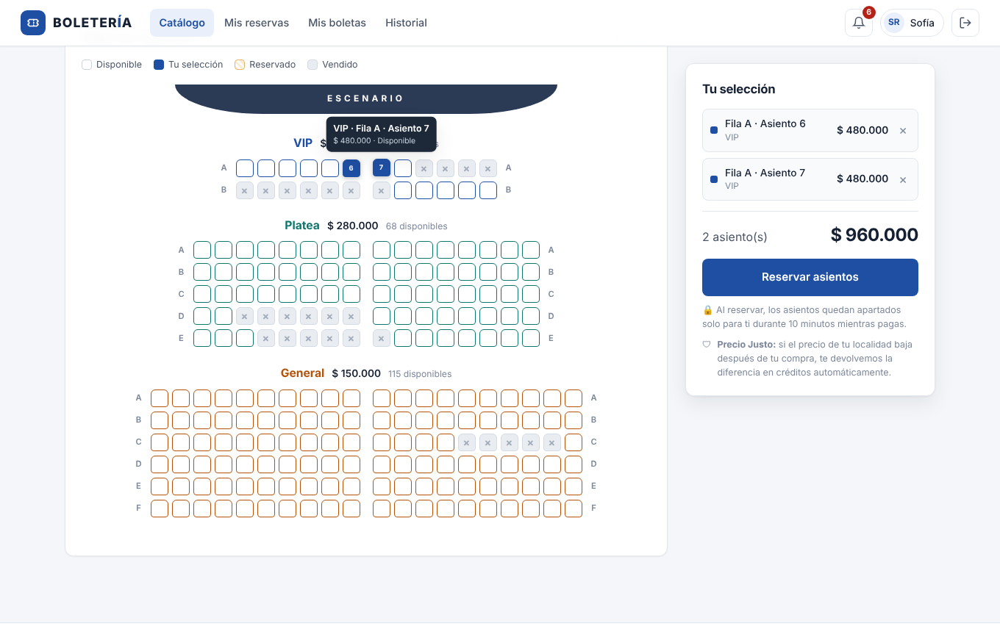
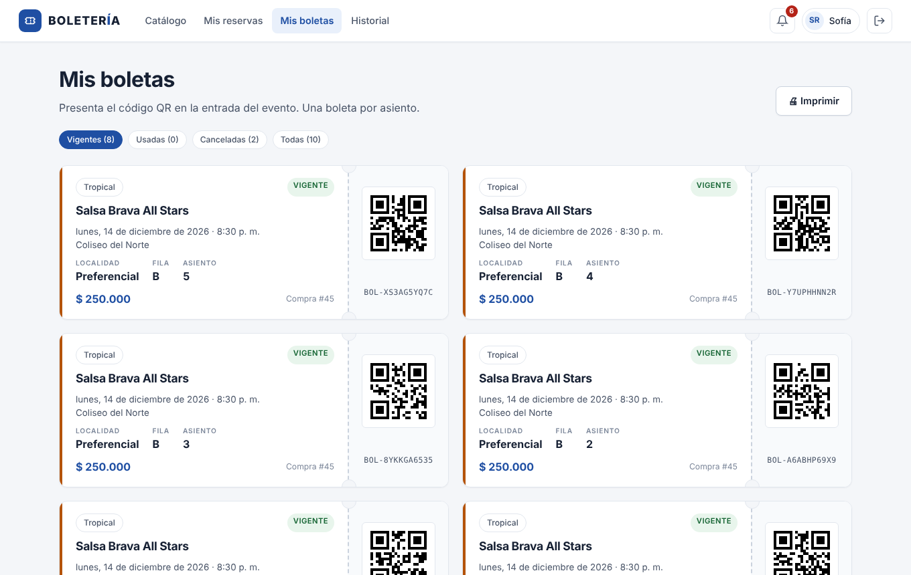
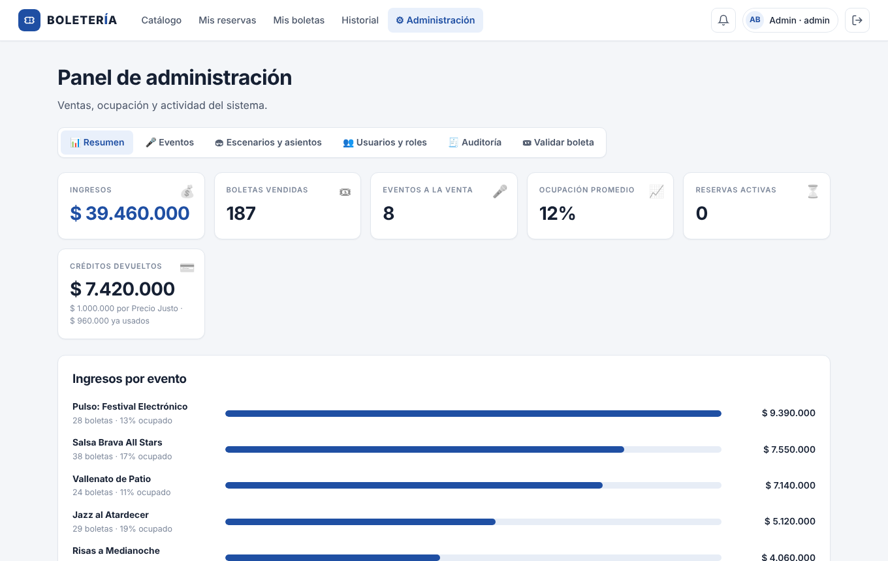
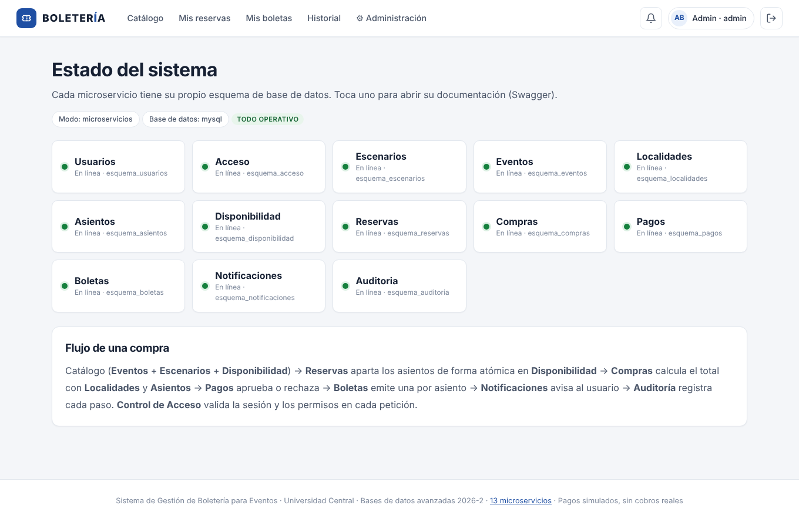

# 🎫 Sistema de Gestión de Boletería para Eventos

**Universidad Central · Bases de datos avanzadas · 2026-2**
**Integrantes:** Luisa Fernanda Arenales Reyes · Cristian Camilo Gil Rodríguez

Sistema completo de venta de boletas para conciertos y eventos, construido con los **13 microservicios**
definidos en el documento de los Sprints 0–3. Cada microservicio tiene su propio esquema de base de
datos (Tablas 48 a 60). La aplicación web incluye un catálogo interactivo, un mapa de asientos en vivo,
el pago simulado, boletas con código QR y un panel de administración.

> Evolución del proyecto *CineTicket* (Java/Spring, grupo 8) hacia Python (FastAPI), conservando sus
> ideas: base de datos en la nube (Neon), flujo reserva → pago → boleta y servicios desacoplados.



| Mapa de asientos en vivo | Boletas con QR |
|---|---|
|  |  |
| **Panel de administración** | **Estado de los 13 microservicios** |
|  |  |

---

## 1. Cómo verlo funcionando (elige una opción)

### Opción A · GitHub Codespaces (recomendada para mostrarle al profesor)
1. Sube esta carpeta a un repositorio de GitHub.
2. En el repositorio: **Code → Codespaces → Create codespace on main** (elige la máquina de 4 núcleos).
3. Espera de 3 a 5 minutos: el Codespace instala todo y ejecuta `docker compose up -d --build` solo.
4. Se abre la aplicación en el puerto **8080**. Para compartir el enlace con el profesor, en la terminal:
   ```bash
   bash scripts/publicar_codespace.sh
   ```
   Imprime dos enlaces públicos: la **aplicación** y **Adminer** (para ver la base de datos en el navegador).

> Un Codespace se apaga tras 30 minutos sin uso; se vuelve a encender desde github.com/codespaces y
> los datos se conservan.

### Opción B · Docker en cualquier computador
```bash
cp .env.example .env          # opcional: cambia contraseñas y la clave interna
docker compose up -d --build
```
| Qué | Dónde |
|---|---|
| Aplicación web | http://localhost:8080 |
| Ver la base de datos (Adminer) | http://localhost:8081 → servidor `mysql`, usuario `boleteria`, clave `boleteria_pass` |
| MySQL Workbench | `localhost:3306`, usuario `boleteria` (o `root` / `root_pass`) |
| Estado de los 13 servicios | http://localhost:8080/#/sistema |
| Swagger de cada servicio | http://localhost:8080/api/eventos/docs (cambia `eventos` por cualquiera) |

Para empezar desde cero: `docker compose down -v && docker compose up -d --build`.

### Opción C · En la nube con enlace permanente (Render + Neon, gratis)
Modo **todo-en-uno**: un solo contenedor con los 13 microservicios montados y la base PostgreSQL en
[Neon](https://neon.tech) (un *schema* por microservicio dentro de la misma base, como en CineTicket).
1. Crea un proyecto en Neon y copia su *connection string* (`postgresql://...neon.tech/neondb?sslmode=require`).
2. En [Render](https://render.com): **New → Blueprint** → elige el repositorio (usa `render.yaml`).
3. Pega la URL de Neon en `DATABASE_URL_TEMPLATE`. Render te da un enlace `https://boleteria-xxxx.onrender.com`.
4. Las tablas se ven en la consola de Neon (*Tables*), agrupadas en los 13 esquemas `esquema_*`.

> El plan gratuito de Render "duerme" el servicio tras 15 min sin visitas; la primera carga tarda ~1 minuto.

### Opción D · Sin Docker (desarrollo)
```bash
python -m venv .venv && source .venv/bin/activate        # Windows: .venv\Scripts\activate
pip install -r requirements.txt
# En .env define DATABASE_URL_TEMPLATE (MySQL local o Neon) y luego:
python -m scripts.run_dev        # 13 servicios en 8001-8013, analítica en 8014 + gateway y web en 8080
```

## 2. Cuentas y datos de demostración
Al arrancar por primera vez, el gateway carga datos de ejemplo **usando las mismas APIs** (no inserta
directo en la base): 3 escenarios, 9 localidades, 602 asientos, 8 eventos y 44 compras pagadas.

| Rol | Correo | Contraseña |
|---|---|---|
| Administrador | `admin@boleteria.com` | `Admin12345` |
| Usuario | `usuario@boleteria.com` | `Usuario12345` |

En la pantalla de inicio hay botones para entrar con cada cuenta. **Tarjetas de prueba** (pago simulado):
`4242 4242 4242 4242` se aprueba · `4000 0000 0000 0002` se rechaza. El número de tarjeta nunca se guarda.

## 3. Recorrido sugerido para la sustentación
1. **Usuario** → catálogo (búsqueda, filtros por escenario/mes/género/precio, destacado con cuenta regresiva).
2. Abre un evento → mapa de asientos por localidad, con precio y tooltip → elige asientos → **Reservar**.
3. Aparece el temporizador de 10 min (RN16) → **Pagar** con la tarjeta aprobada → boletas con QR.
4. Prueba la tarjeta rechazada: los asientos vuelven a quedar libres (RN17).
5. Abre el mismo evento en otra ventana con otra cuenta: el mapa se actualiza solo cada 6 s.
6. **Administrador** → Resumen de ventas · crear escenario → localidad → *Generar asientos* → crear evento
   (publica la disponibilidad) · Validar boleta (marcar usada) · Cancelar evento · Roles · Auditoría con filtros.
7. En Adminer, abre `esquema_auditoria` e intenta borrar un registro: el trigger lo impide (RN19).
8. **Estados y créditos** (ver sección 3.1): cambia la fecha de un evento (queda *Aplazado*), cancela
   «Noche de Cumbia Eléctrica» (el usuario demo recibe sus créditos), baja el precio de una localidad
   (Precio Justo) y luego reactiva el evento. Entra como usuario y paga con «Usar mis créditos».

## 3.1 Novedades: estados, créditos, imágenes y Precio Justo

**Estados del evento**
```
programado ──cambiar fecha u hora──► aplazado ──(puede volver a cambiar)──► aplazado
     │                                   │
     └──────────── cancelar ─────────────┴──► cancelado ──editar y reactivar──► programado (misma fecha)
     │                                                                        aplazado   (otra fecha)
     └── fecha pasada (automático) o «Realizado» ──► realizado (final)
```
* **Aplazado**: sigue a la venta, las boletas siguen válidas y se notifica a quienes ya compraron.
* **Cancelado**: se cancelan las reservas activas, las boletas vendidas pasan a *cancelada* y su valor
  se devuelve **en créditos**; los asientos quedan libres. Editarlo lo **reactiva** (con fecha futura).
* **Realizado**: automático cuando la fecha ya pasó (o manual). Su historial se conserva (RN14).

**Créditos (nuevo medio de pago).** Cada usuario tiene un monedero (tabla `credito` en `esquema_pagos`):
abonos por evento cancelado o Precio Justo, y usos al pagar. En el pago se marca «Usar mis créditos»:
si alcanzan, se paga solo con créditos; si no, el resto con tarjeta (pago *mixto*). Si la tarjeta se
rechaza, los créditos no se tocan. La página **Créditos** muestra el saldo y los movimientos.

**🛡 Precio Justo Garantizado (la función innovadora).** Si el administrador **baja** el precio de una
localidad, a cada persona que ya compró boletas vigentes en esa localidad, para un evento que aún no
ocurre, se le devuelve **automáticamente** la diferencia en créditos y se le notifica. Nunca hay
reembolsos dobles: si el precio baja dos veces se devuelve solo la nueva diferencia, subirlo no cobra
nada, y si después el evento se cancela se completa exactamente lo pagado.

**Imagen del evento.** En *Administración → Eventos → Editar* se sube una imagen (JPG, PNG o WEBP); el
navegador la ajusta a máximo 1400 px antes de enviarla y se guarda en `esquema_eventos.imagen_evento`.
Sin imagen, se usa el póster generado.

**Cambios al modelo de datos** (documentados en `database/`):
| Esquema | Cambio |
|---|---|
| `esquema_eventos` | estado `aplazado`; tabla `imagen_evento` (1:1 con evento) |
| `esquema_pagos` | `pago.metodo` (tarjeta / creditos / mixto) y `pago.valor_creditos`; tabla `credito` |
| `esquema_boletas` | la unicidad pasa a ser solo entre boletas **vigentes** (columna calculada `vigente_unica`), tal como dice RF-BOL-03; así un asiento de un evento reactivado se puede volver a vender |
| `esquema_notificaciones` | tipos `evento` y `credito` |

> **¿Ya tenías la base creada (por ejemplo en tu Codespace)?** Docker solo ejecuta los scripts SQL la
> primera vez, así que aplica la migración sin perder datos:
> ```bash
> git pull            # o sube los archivos nuevos
> bash scripts/migrar.sh
> ```
> O empieza de cero: `docker compose down -v && docker compose up -d --build`.

## 3.2 Sprints 6 a 8: Kubernetes, Data Warehouse e indicadores
* **Kubernetes:** `k8s/` con un Deployment y un Service por microservicio, MySQL como StatefulSet y el
  gateway con autoescalado. Pasos en [`k8s/README.md`](k8s/README.md).
* **Data Warehouse:** el microservicio `analitica` (puerto 8014, `esquema_analitica`) mantiene un esquema en
  estrella (dimensiones de tiempo, evento, localidad y usuario; hechos de venta, reserva, ocupación y
  crédito). El ETL corre solo cada 10 minutos (`ANALITICA_ETL_MINUTOS`) o con `python -m analitica.etl`.
* **BD distribuidas:** cada microservicio puede usar otro servidor con `<SERVICIO>_DATABASE_URL`; por
  ejemplo, `ANALITICA_DATABASE_URL=postgresql://...` deja el Data Warehouse en PostgreSQL.
* **Dashboard:** Administración → **📈 Indicadores** (ingresos, ocupación, conversión, créditos y bitácora del ETL).

## 4. Arquitectura

```
                         Navegador (SPA: catálogo, mapa de asientos, checkout, admin)
                                              │  un solo origen
                                   ┌──────────▼───────────┐
                                   │   API Gateway :8080  │  /api/<servicio>/... · bloquea /internal
                                   └──────────┬───────────┘
   ┌──────────┬───────────┬──────────┬───────┴─────┬───────────┬──────────┬────────────┐
 Usuarios  Acceso   Escenarios  Eventos  Localidades  Asientos  Disponibilidad  Reservas
 Compras   Pagos    Boletas     Notificaciones  Auditoría            (13 microservicios FastAPI)
   │          │          │         │          │          │           │            │
   └──────────┴──────────┴─────────┴────┬─────┴──────────┴───────────┴────────────┘
                     MySQL 8: un database por servicio (esquema_usuarios … esquema_auditoria)
                     o PostgreSQL/Neon: un schema por servicio dentro de una sola base
```

* **Datos separados.** Ningún servicio lee tablas de otro. Las columnas que apuntan a otro servicio
  (Tabla 61) son *referencias lógicas*: se guardan con índice y el servicio de origen consulta al de
  destino por HTTP antes de guardar (ej. Eventos verifica el escenario; Reservas verifica el evento).
* **Comunicación.** HTTP síncrono con clave interna (`X-Internal-Key`) en las rutas `/internal/*`.
  Auditoría y notificaciones se envían en segundo plano: si fallan, no detienen la operación.
* **Sesión.** Control de Acceso emite un token (se guarda solo su SHA-256). Cada servicio valida el
  token y los permisos del rol en cada petición; cerrar sesión la invalida de inmediato en todos.
* **Una sola imagen Docker** para los 14 contenedores; cada uno arranca un módulo distinto.

### Flujo de una compra (saga orquestada)
```
Reservas ──cambiar disponible→reservado (atómico)──► Disponibilidad
   │  si falla al guardar la reserva: compensa liberando los asientos
Compras ──total = Σ precio de la localidad de cada asiento──► Localidades / Asientos
Pagos (orquestador)
   ├─ aprobado:  Reservas.completar (reservado→vendido) → Compra pagada → Boletas.generar → Notificación
   └─ rechazado: Compra rechazada → Reservas.liberar (reservado→disponible) → sin boletas
Reservas (proceso cada 15 s): reservas vencidas → expirada, libera asientos, anula compra pendiente, notifica
```

## 5. Microservicios y endpoints principales

| Servicio | Esquema | Endpoints (vía gateway: `/api/<servicio>/...`) | Requerimientos |
|---|---|---|---|
| Usuarios | `esquema_usuarios` | `POST /usuarios/registro` · `GET/PUT /usuarios/me` · `GET /usuarios` (admin) | RF-USR-01 a 03 |
| Control de Acceso | `esquema_acceso` | `POST /auth/login` · `POST /auth/logout` · `GET /auth/me` · `GET /roles` · `PUT /credenciales/{id}/rol` | RF-ACC-01 a 03 |
| Escenarios | `esquema_escenarios` | `GET/POST /escenarios` · `PUT/DELETE /escenarios/{id}` | RF-ESC-01 a 03 |
| Eventos | `esquema_eventos` | `GET /eventos` · `GET /eventos/todos` · `POST /eventos` · `PUT /eventos/{id}` · `PUT /eventos/{id}/estado` · `POST /eventos/{id}/publicar` · `PUT/DELETE/GET /eventos/{id}/imagen` | RF-EVE-01 a 03 |
| Localidades | `esquema_localidades` | `GET/POST /localidades` · `PUT/DELETE /localidades/{id}` | RF-LOC-01 y 02 |
| Asientos | `esquema_asientos` | `GET /asientos?id_localidad=` · `POST /asientos` · `POST /asientos/generar` | RF-ASI-01 y 02 |
| Disponibilidad | `esquema_disponibilidad` | `GET /disponibilidad/eventos/{id}` · `GET /disponibilidad/resumen` | RF-DIS-01 a 03 |
| Reservas | `esquema_reservas` | `POST /reservas` · `GET /reservas/mis` · `PUT /reservas/{id}/cancelar` | RF-RES-01 a 04 |
| Compras | `esquema_compras` | `POST /compras` · `GET /compras/mis` · `GET /historial` | RF-COM-01 a 03 |
| Pagos | `esquema_pagos` | `POST /pagos` (tarjeta, créditos o mixto) · `GET /pagos/compra/{id}` · `GET /creditos/mis` · `GET /creditos/resumen` | RF-PAG-01 a 03 + créditos |
| Boletas | `esquema_boletas` | `GET /boletas/mis` · `GET /boletas/{codigo}` · `GET /boletas/qr/{codigo}.svg` · `PUT /boletas/{codigo}/usar` · `GET /boletas/resumen` | RF-BOL-01 a 03 |
| Notificaciones | `esquema_notificaciones` | `GET /notificaciones/mis` · `POST /notificaciones/marcar-enviadas` | RF-NOT-01 a 03 |
| Auditoría | `esquema_auditoria` | `GET /auditoria?id_usuario=&accion=&desde=&hasta=` · `GET /auditoria/acciones` | RF-AUD-01 a 03 |

La documentación interactiva (Swagger) de cada uno está en `/api/<servicio>/docs`.

## 6. Cómo se cumplen las reglas del negocio

| Regla | Implementación |
|---|---|
| RN01–RN02 | `UNIQUE` en correo y documento; todos los campos obligatorios (Pydantic + `NOT NULL`). |
| RN04–RN06 | Referencias lógicas validadas por HTTP; `UNIQUE (id_escenario, nombre)` y `UNIQUE (id_localidad, fila, numero)`. La suma de localidades no supera la capacidad del escenario; los asientos no superan la de su localidad. |
| RN13, RN15, RN22 | `disponibilidad_asiento (id_evento, id_asiento)` con un solo `UPDATE … WHERE estado = 'disponible'`: si cambia menos filas de las pedidas, se revierte todo. Probado con 20–30 compradores simultáneos: un solo ganador por asiento. |
| RN14 / RNF06 | Sin borrado físico de reservas, compras ni boletas (`ON DELETE RESTRICT`, estados). Cancelar un evento conserva el historial. |
| RN15 (boleta) | `UNIQUE (id_evento, id_asiento)` en `boleta`. |
| RN16 | `fecha_vencimiento` (`RESERVA_MINUTOS`, 10 por defecto) y proceso de expiración en segundo plano. |
| RN17–RN18 | La compra solo pasa a *pagada* con pago aprobado; rechazado → asientos liberados, sin boletas. Una boleta por asiento con código único. |
| RN19 | Auditoría sin endpoints de edición; en MySQL el usuario de la aplicación no tiene `UPDATE`/`DELETE` y hay triggers que lo rechazan (también en PostgreSQL). |
| RN20 | Permisos por rol (`rol_permiso`); las rutas de administración exigen el permiso correspondiente. |
| RN21 | Notificación al reservar, al aprobarse/rechazarse el pago y al expirar una reserva (campana en la web). |
| RNF02 | El id del usuario sale de la sesión, nunca del cliente; reservas, compras y boletas ajenas responden 404. |
| RNF03 | Índices en `(id_evento, estado)`, `(estado, fecha_vencimiento)`, llaves de referencia, etc. |
| RNF05 | `bash scripts/backup.sh` (mysqldump de los 13 esquemas con triggers) y `bash scripts/restore.sh <archivo>`. |

## 7. Base de datos
* `database/00_crear_esquemas.sql` crea los 13 esquemas y los permisos; `01` a `13` contienen el DDL de
  cada microservicio, con llaves primarias, foráneas internas, `UNIQUE`, `CHECK` e índices.
  Docker los ejecuta automáticamente la primera vez.
* Los servicios también pueden crear sus tablas (`AUTO_CREATE_TABLES=true`), útil con Neon.

## 8. Pruebas
```bash
python -m pytest -q        # 82 pruebas de integración; levantan los 14 servicios reales con SQLite temporal
```
Cubren registro, login, roles, catálogo, permisos, reserva todo-o-nada, concurrencia, cancelación,
expiración, compra única por reserva, pago aprobado/rechazado, unicidad de boletas, historial,
notificaciones, auditoría, cancelación de eventos, aplazamiento, reactivación con reventa del mismo
asiento, pago con créditos (total, mixto y con tarjeta rechazada), Precio Justo sin dobles reembolsos e
imágenes de eventos, y el ETL del Data Warehouse con sus indicadores. El sistema también se verificó contra MySQL/MariaDB
(solo con los scripts DDL) y contra PostgreSQL en modo todo-en-uno.

## 9. Estructura
```
common/           configuración, BD multi-motor, autenticación, cliente HTTP, auditoría, notificaciones
usuarios/ acceso/ escenarios/ eventos/ localidades/ asientos/ disponibilidad/
reservas/ compras/ pagos/ boletas/ notificaciones/ auditoria/      ← un paquete por microservicio
analitica/        Data Warehouse (esquema en estrella), ETL e indicadores (Sprints 7 y 8)
k8s/              manifiestos de Kubernetes (Sprint 6) · ver k8s/README.md
gateway/          API gateway + modo todo-en-uno
frontend/         index.html, styles.css, core.js, app.js (usuario), admin.js (administración)
database/         DDL MySQL de los 13 esquemas y del Data Warehouse (14_esquema_analitica.sql)
scripts/          seed.py (datos demo) · run_dev.py · crear_admin.py · backup.sh · restore.sh · migrar.sh · publicar_codespace.sh
tests/            pruebas de integración
.devcontainer/    configuración de GitHub Codespaces
Dockerfile · docker-compose.yml · render.yaml
```

## 10. Alcance (según el documento)
No incluye pasarela de pagos real (el pago es simulado), control físico de ingreso (solo se puede marcar
una boleta como usada desde el panel) ni facturación electrónica. Tampoco recuperación de contraseña ni
envío de correos reales: las notificaciones se entregan dentro de la aplicación.
